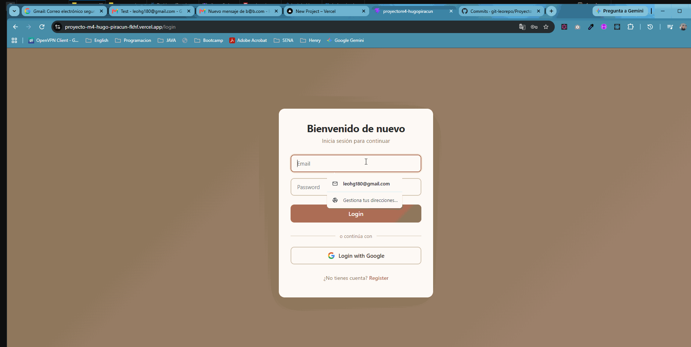
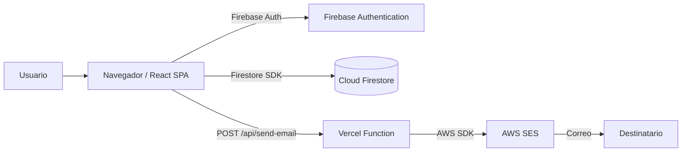
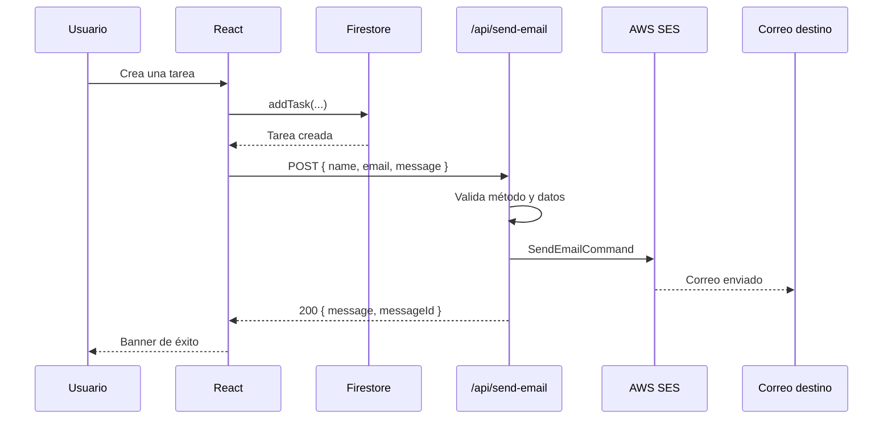
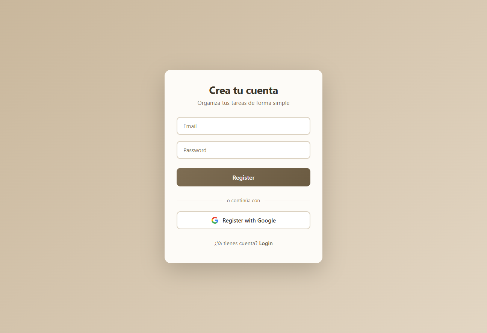
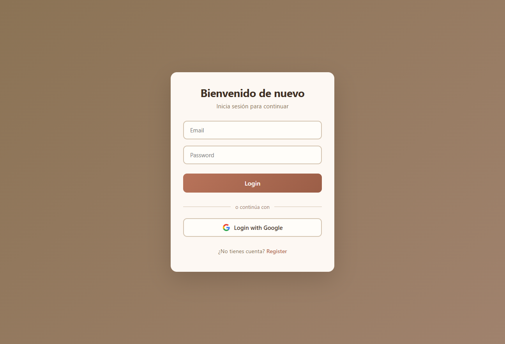
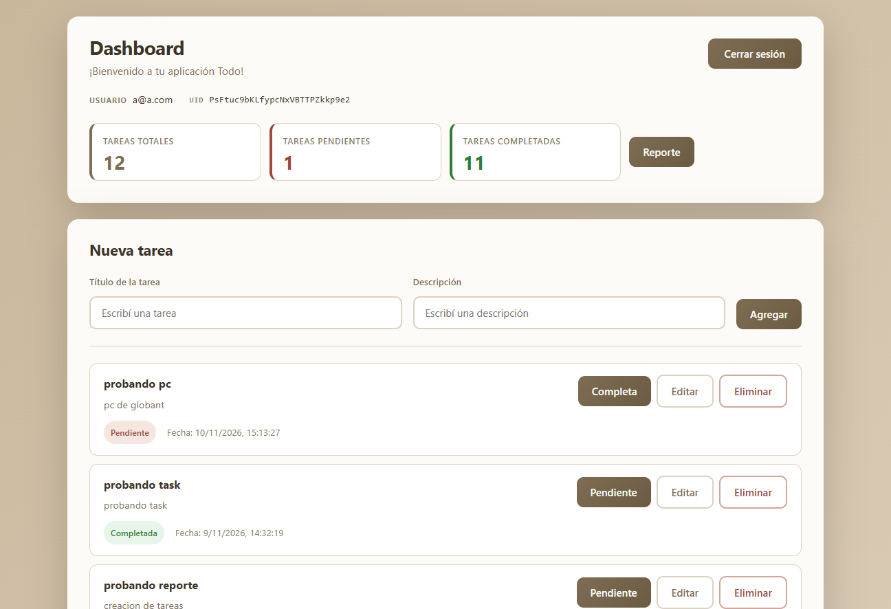
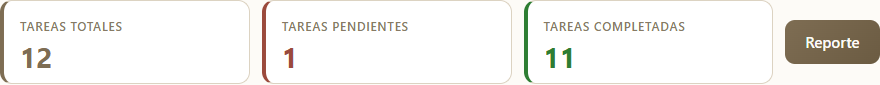

# ✅ Todo App — Proyecto M4


Aplicación web tipo **TODO** para crear, organizar y completar tareas personales. Incluye autenticación con email/contraseña y Google, persistencia en **Cloud Firestore**, envío de correos con **AWS SES** y despliegue en **Vercel**.

> Proyecto desarrollado como parte del **Módulo 4** del programa de Desarrollo Full Stack. El objetivo es practicar React, TypeScript, autenticación, bases de datos NoSQL, servicios serverless y despliegue en la nube.

---

## 📑 Contenido

- [🚀 Introducción del proyecto](#introduccion)
- [📝 Descripción del proyecto](#descripcion)
- [🎬 Demo de la app](#demo)
- [🧭 Cómo probar la aplicación (evaluación)](#evaluacion)
- [✨ Funcionalidades](#funcionalidades)
- [🧰 Stack tecnológico](#stack)
- [🏗️ Arquitectura y decisiones](#arquitectura)
- [📦 Instalación](#instalacion)
- [💻 Despliegue local](#local)
- [▲ Despliegue en Vercel](#vercel)
- [🔗 URLs de despliegue](#urls)
- [🗂️ Scaffolding](#scaffolding)
- [🔥 Configuración de Firebase](#firebase)
- [🗄️ Configuración de Firestore](#firestore)
- [☁️ Configuración de AWS SES](#aws)
- [🔐 Variables de entorno](#variables)
- [⚙️ Configuración de los servicios](#servicios)
- [📧 Flujo de envío de emails](#emails)
- [🛡️ Seguridad](#seguridad)
- [🖼️ Pantallas de cada vista](#pantallas)
- [🧪 Cómo generar los tests](#tests)
- [📌 Notas y limitaciones](#notas)
- [🤖 Consultas IA](#consultas-ia)

---

<a name="introduccion"></a>
## 🚀 Introducción del proyecto

**Todo App** es una aplicación full stack pensada para gestionar tareas de forma simple. El usuario puede registrarse, iniciar sesión, crear tareas, marcarlas como completadas, editarlas o eliminarlas, y recibir un correo con el detalle de cada tarea creada o con un resumen de su tablero.

El proyecto surge como práctica integradora del Módulo 4 y reúne, en una sola aplicación:

- Un frontend SPA construido con React y TypeScript.
- Autenticación real con Firebase Authentication.
- Persistencia de datos en Cloud Firestore.
- Una función serverless en Vercel para enviar correos con AWS SES.
- Tests automatizados con Vitest y Testing Library.
- Despliegue en Vercel.

La aplicación está pensada para ejecutarse tanto en local como en producción, manteniendo las credenciales sensibles fuera del navegador.

---

<a name="descripcion"></a>
## 📝 Descripción del proyecto

Todo App permite administrar un listado personal de tareas asociado a cada usuario autenticado. Cada tarea tiene:

| Campo | Tipo | Descripción |
|---|---|---|
| `id` | `string` | ID generado por Firestore. |
| `title` | `string` | Título de la tarea. |
| `description` | `string` | Descripción opcional. |
| `completed` | `boolean` | Indica si la tarea está completada. |
| `userId` | `string` | UID del usuario dueño de la tarea. |
| `createdAt` | `string` | Fecha de creación en formato ISO 8601. |

### Flujo general

1. El usuario se registra o inicia sesión.
2. Firebase Authentication devuelve el usuario y su `uid`.
3. El Dashboard carga las tareas del usuario desde Firestore.
4. Al crear una tarea, se guarda en Firestore y se envía un correo con AWS SES.
5. El usuario puede completar, editar o eliminar sus tareas.
6. El botón **Reporte** envía un correo con el resumen de tareas.
7. Al cerrar sesión, se vuelve al Login y el Dashboard queda protegido.

### Diseño visual

La interfaz usa tres temas cálidos:

| Vista | Tema |
|---|---|
| Login | Tonos tierra / marrón. |
| Sign Up | Beige arena. |
| Dashboard | Beige arena con acentos beige, rojo terracota y verde. |

Los estilos de cada página viven en su propio archivo CSS y usan variables locales para mantener la paleta.

---

<a name="demo"></a>
## 🎬 Demo de la app

Un recorrido visual por la aplicación: registro, login, creación de tareas, cambio de estado, edición, eliminación y envío del reporte por correo.



---

<a name="evaluacion"></a>
## 🧭 Cómo probar la aplicación (evaluación)

### 1. Abrir la aplicación

Usa la URL de producción o levanta el proyecto en local:

| Entorno | URL |
|---|---|
| Producción | https://proyecto-m4-hugo-piracun-fkhf.vercel.app/ |
| Local (frontend) | http://localhost:5173 |
| Local (con API) | http://localhost:3000 |

### 2. Cuenta demo

| Campo | Valor |
|---|---|
| Email | a@a.com |
| Contraseña | aaaa1111 |

Si la cuenta demo no existe, crea una nueva desde la pantalla de registro.

### 3. Recorrido sugerido

1. **Registro:** entra a `/`, completa email y contraseña, o usa **Register with Google**.
2. **Login:** cierra sesión y vuelve a entrar desde `/login`.
3. **Crear tarea:** escribe un título de al menos 2 caracteres y una descripción.
4. **Verificar el correo:** si AWS SES está configurado, revisa la bandeja de `SES_TO_EMAIL`.
5. **Listado:** confirma que la tarea aparece con su fecha y el badge **Pendiente**.
6. **Completar:** pulsa **Completa** y verifica que el badge cambie a **Completada**.
7. **Editar:** pulsa **Editar**, modifica título o descripción y guarda.
8. **Eliminar:** pulsa **Eliminar** y confirma que la tarea desaparezca.
9. **Resumen:** verifica que los contadores de totales, pendientes y completadas se actualicen.
10. **Reporte:** pulsa **Reporte** y confirma el correo con el resumen.
11. **Ruta protegida:** sin sesión, intenta abrir `/dashboard`; debe redirigir a `/login`.
12. **Responsive:** prueba la vista en un ancho menor a 600 px.
13. **Tests:** ejecuta `npm test -- --run` y confirma que los 5 tests pasan.

### 4. Consideraciones

- `npm run dev` **no** ejecuta la API de correos. Para probar el envío en local usa `npm run dev:vercel`.
- El envío real de correos requiere credenciales de AWS SES y un remitente verificado.
- Si el correo falla, la tarea puede haberse creado igualmente en Firestore. Ver [Notas y limitaciones](#notas).

---

<a name="funcionalidades"></a>
## ✨ Funcionalidades

### Autenticación

- [x] Registro con email y contraseña.
- [x] Inicio de sesión con email y contraseña.
- [x] Registro e inicio de sesión con Google.
- [x] Persistencia de sesión con `onAuthStateChanged`.
- [x] Cierre de sesión.
- [x] Protección de la ruta `/dashboard`.
- [x] Mensajes de error de Firebase traducidos al español.

### Tareas

- [x] Crear tareas con título y descripción.
- [x] Listar solo las tareas del usuario autenticado.
- [x] Ordenar por fecha de creación descendente.
- [x] Marcar una tarea como completada o pendiente.
- [x] Editar título y descripción en línea.
- [x] Eliminar tareas.
- [x] Mostrar fecha de creación y badge de estado.
- [x] Estado vacío cuando no hay tareas.

### Resumen y reportes

- [x] Contador de tareas totales.
- [x] Contador de tareas pendientes.
- [x] Contador de tareas completadas.
- [x] Botón **Reporte** con estado de envío.
- [x] Banner de feedback para éxito, error y carga.

### Correos

- [x] Correo al crear una tarea.
- [x] Correo con el resumen de tareas.
- [x] Remitente y destinatario configurables por variables de entorno.
- [x] `Reply-To` con el email del usuario.
- [x] Validación del cuerpo de la petición en la función serverless.

### Calidad

- [x] TypeScript en todo el frontend y en la función serverless.
- [x] ESLint configurado.
- [x] Tests con Vitest y Testing Library.
- [x] Diseño responsive.
- [x] Build de producción con Vite.

---

<a name="stack"></a>
## 🧰 Stack tecnológico

| Capa | Tecnología | Versión | Uso |
|---|---|---|---|
| UI | React | `^19.2.8` | Componentes y estado. |
| UI | React DOM | `^19.2.8` | Render en el navegador. |
| Lenguaje | TypeScript | `~6.0.2` | Tipado estático. |
| Bundler | Vite | `^8.3.0` | Desarrollo y build. |
| Rutas | React Router DOM | `^7.18.3` | Navegación SPA. |
| Auth | Firebase Authentication | `^12.19.0` | Registro, login y sesión. |
| Base de datos | Cloud Firestore | `^12.19.0` | Persistencia de tareas. |
| Email | AWS SES | `^3.1162.0` | Envío de correos. |
| Serverless | Vercel Functions | `^29.0.1` (tipos) | Endpoint `/api/send-email`. |
| Tests | Vitest | `^5.1.0` | Test runner. |
| Tests | Testing Library | `^16.3.3` | Render y consultas DOM. |
| Tests | jsdom | `^31.0.0` | Entorno DOM para tests. |
| Lint | ESLint + typescript-eslint | `^10.10.0` / `^8.69.0` | Calidad de código. |
| Deploy | Vercel | — | Hosting y funciones. |

---

<a name="arquitectura"></a>
## 🏗️ Arquitectura y decisiones

### Diagrama general



### Capas del frontend

| Capa | Archivos | Responsabilidad |
|---|---|---|
| Entrada | `src/main.tsx`, `src/App.tsx` | Montar React, rutas y providers. |
| Páginas | `src/pages/*` | Vistas de Login, SignUp y Dashboard. |
| Componentes | `src/componentes/*` | `RequireAuth` y botón reutilizable. |
| Auth | `src/features/auth/*` | Contexto de autenticación y mensajes de error. |
| Servicios | `src/services/*` | Inicialización de Firebase y CRUD de tareas. |
| Tipos | `src/types/types.ts` | Contratos de datos. |
| Estilos | `src/pages/*.css`, `src/index.css` | Temas y estilos globales. |
| API | `api/send-email.ts` | Función serverless de correo. |

### Decisiones y motivos

| Decisión | Motivo | Trade-off |
|---|---|---|
| Context API para auth | La app tiene un único estado global pequeño. | Si crece, conviene evaluar Zustand o Redux. |
| Firestore como base | Persistencia en la nube sin backend propio. | Requiere reglas e índices. |
| Vercel Functions para el correo | Las claves de AWS nunca llegan al navegador. | Depende de Vercel para el envío. |
| CSS por página | Cada vista tiene su tema sin librerías externas. | Hay estilos repetidos entre archivos. |
| TypeScript | Contratos claros para tareas y respuestas de API. | Más código y configuración. |
| Vitest + Testing Library | Integración natural con Vite y React. | La cobertura todavía es básica. |
| Sin librería de formularios | Los formularios son simples y controlados. | La validación se hace a mano. |

### Notas técnicas

- `getTasks` consulta `where("userId", "==", userId)` y `orderBy("createdAt", "desc")`. Firestore exige un **índice compuesto** para esa combinación.
- `createdAt` se guarda como string ISO, no como `Timestamp`. El orden lexicográfico de ISO 8601 coincide con el orden cronológico.
- La app no usa `onSnapshot`; recarga las tareas al montar y actualiza el estado después de cada operación.
- `RequireAuth` es el guard activo. `src/routes/ProtectedRoute.tsx` está comentado y no se usa.

---

<a name="instalacion"></a>
## 📦 Instalación

### Requisitos previos

| Herramienta | Versión recomendada | Verificación |
|---|---|---|
| Node.js | 22 o superior (probado con 24) | `node -v` |
| npm | 10 o superior | `npm -v` |
| Git | Última estable | `git --version` |
| Vercel CLI | Opcional para probar la API | `vercel -v` |

### Clonar e instalar

```bash
git clone https://github.com/git-leorepo/ProyectoM4_HugoPiracun.git
cd ProyectoM4_HugoPiracun
npm install
```

`npm install` instala **todas** las dependencias declaradas en `package.json`. No hace falta instalar React, Vite, Firebase ni AWS por separado.

### Dependencias de producción

| Paquete | Versión | Para qué sirve |
|---|---|---|
| `@aws-sdk/client-ses` | `^3.1162.0` | Enviar correos con AWS SES desde la función serverless. |
| `firebase` | `^12.19.0` | Authentication y Firestore. |
| `react` | `^19.2.8` | Librería de UI. |
| `react-dom` | `^19.2.8` | Render de React en el navegador. |
| `react-router-dom` | `^7.18.3` | Rutas de la SPA. |

### Dependencias de desarrollo

| Paquete | Versión | Para qué sirve |
|---|---|---|
| `@eslint/js` | `^10.0.1` | Reglas base de ESLint. |
| `@testing-library/jest-dom` | `^7.0.1` | Matchers de DOM para tests. |
| `@testing-library/react` | `^16.3.3` | Render de componentes en tests. |
| `@testing-library/user-event` | `^14.6.9` | Simulación de interacciones de usuario. |
| `@types/node` | `^24.13.3` | Tipos de Node.js. |
| `@types/react` | `^19.2.18` | Tipos de React. |
| `@types/react-dom` | `^19.2.7` | Tipos de React DOM. |
| `@vercel/node` | `^29.0.1` | Tipos para Vercel Functions. |
| `@vitejs/plugin-react` | `^6.1.1` | Plugin de React para Vite. |
| `eslint` | `^10.10.0` | Linter. |
| `eslint-plugin-react-hooks` | `^7.1.1` | Reglas de hooks. |
| `eslint-plugin-react-refresh` | `^0.5.6` | Reglas de Fast Refresh. |
| `globals` | `^17.12.0` | Variables globales para ESLint. |
| `jsdom` | `^31.0.0` | DOM simulado para tests. |
| `typescript` | `~6.0.2` | Compilador y tipos. |
| `typescript-eslint` | `^8.69.0` | ESLint para TypeScript. |
| `vite` | `^8.3.0` | Dev server y build. |
| `vitest` | `^5.1.0` | Test runner. |

### Herramientas globales opcionales

```bash
# Vercel CLI: necesaria para `npm run dev:vercel` y para desplegar
npm install -g vercel

# Opcional: administrar Firebase desde la terminal
npm install -g firebase-tools

# Opcional: administrar AWS desde la terminal
# https://docs.aws.amazon.com/cli/latest/userguide/getting-started-install.html
```

También puedes usar `npx vercel` sin instalación global.

---

<a name="local"></a>
## 💻 Despliegue local

### 1. Configurar variables de entorno

Copia el archivo de ejemplo y completa los valores:

```bash
# Windows (PowerShell)
Copy-Item .env.example .env

# macOS / Linux
cp .env.example .env
```

Edita `.env` con tus credenciales. El detalle está en [Variables de entorno](#variables).

### 2. Ejecutar solo el frontend

```bash
npm run dev
```

Abre http://localhost:5173.

> En este modo **no** existe `/api/send-email`. Las tareas se guardan en Firestore, pero el correo falla.

### 3. Ejecutar frontend + API

```bash
npm run dev:vercel
```

Abre http://localhost:3000. Este comando levanta Vite y la función serverless, por lo que el envío de correos sí funciona.

Si `vercel dev` no toma las variables del `.env`, puedes cargarlas en el proyecto de Vercel o ejecutar:

```bash
vercel env pull .env.local
```

### 4. Scripts disponibles

| Script | Comando | Qué hace |
|---|---|---|
| `dev` | `npm run dev` | Vite en modo desarrollo (sin API). |
| `dev:vercel` | `npm run dev:vercel` | Vercel CLI con funciones serverless. |
| `build` | `npm run build` | TypeScript + build de producción en `dist/`. |
| `preview` | `npm run preview` | Sirve el build de producción. |
| `lint` | `npm run lint` | Ejecuta ESLint. |
| `test` | `npm test` | Vitest en modo interactivo. |
| `test:watch` | `npm run test:watch` | Vitest en modo watch. |

### 5. Build de producción

```bash
npm run build
npm run preview
```

El resultado queda en `dist/`.

---

<a name="vercel"></a>
## ▲ Despliegue en Vercel

### 1. Preparar el repositorio

Sube el proyecto a GitHub. Vercel puede desplegar desde la rama principal o desde cualquier rama.

### 2. Importar el proyecto

1. Entra a [vercel.com](https://vercel.com).
2. Pulsa **Add New → Project**.
3. Importa el repositorio `ProyectoM4_HugoPiracun`.
4. Configura:
   - **Framework Preset:** Vite.
   - **Build Command:** `npm run build`.
   - **Output Directory:** `dist`.
   - **Install Command:** `npm install`.

### 3. Configurar variables de entorno

En **Settings → Environment Variables**, agrega las 9 variables:

| Variable | Entorno | Cuándo se usa |
|---|---|---|
| `VITE_FIREBASE_API_KEY` | Production / Preview / Development | Build del frontend. |
| `VITE_FIREBASE_AUTH_DOMAIN` | Production / Preview / Development | Build del frontend. |
| `VITE_FIREBASE_PROJECT_ID` | Production / Preview / Development | Build del frontend. |
| `VITE_FIREBASE_APP_ID` | Production / Preview / Development | Build del frontend. |
| `AWS_REGION` | Production / Preview | Runtime de la función. |
| `AWS_ACCESS_KEY_ID` | Production / Preview | Runtime de la función. |
| `AWS_SECRET_ACCESS_KEY` | Production / Preview | Runtime de la función. |
| `SES_FROM_EMAIL` | Production / Preview | Runtime de la función. |
| `SES_TO_EMAIL` | Production / Preview | Runtime de la función. |

> Las variables `VITE_*` se incrustan en el bundle y son públicas. Las variables de AWS **no** deben llevar el prefijo `VITE_`.

También puedes usar la CLI:

```bash
vercel env add VITE_FIREBASE_API_KEY
vercel env add VITE_FIREBASE_AUTH_DOMAIN
vercel env add VITE_FIREBASE_PROJECT_ID
vercel env add VITE_FIREBASE_APP_ID
vercel env add AWS_REGION
vercel env add AWS_ACCESS_KEY_ID
vercel env add AWS_SECRET_ACCESS_KEY
vercel env add SES_FROM_EMAIL
vercel env add SES_TO_EMAIL
```

### 4. Desplegar

```bash
vercel --prod
```

O pulsa **Deploy** desde el dashboard.

### 5. Configurar rutas SPA

React Router maneja `/`, `/login` y `/dashboard`. Si al recargar `/login` o `/dashboard` aparece un 404, agrega un `vercel.json` en la raíz:

```json
{
  "$schema": "https://openapi.vercel.sh/vercel.json",
  "rewrites": [
    { "source": "/login", "destination": "/index.html" },
    { "source": "/dashboard", "destination": "/index.html" }
  ]
}
```

Si agregas rutas nuevas, súmalas a la lista. Evita un rewrite global que pueda interceptar `/api/` o `/assets/`.

### 6. Post-despliegue

1. Copia el dominio de Vercel (por ejemplo, `https://tu-proyecto.vercel.app`).
2. En Firebase, agrega ese dominio en **Authentication → Settings → Authorized domains**.
3. Verifica que `POST /api/send-email` responda correctamente.
4. Revisa los logs de la función en **Vercel → Deployments → Functions**.
5. Si cambias variables de entorno, vuelve a desplegar.

### 7. Dominio personalizado (opcional)

1. **Settings → Domains → Add**.
2. Configura los registros DNS indicados por Vercel.
3. Agrega el dominio personalizado a los dominios autorizados de Firebase.

---

<a name="urls"></a>
## 🔗 URLs de despliegue

| Recurso | URL |
|---|---|
| Repositorio | https://github.com/git-leorepo/ProyectoM4_HugoPiracun |
| Producción | https://proyecto-m4-hugo-piracun-fkhf.vercel.app/ |
| Login | https://proyecto-m4-hugo-piracun-fkhf.vercel.app/login |
| Dashboard | https://proyecto-m4-hugo-piracun-fkhf.vercel.app/dashboard |
| Local (frontend) | http://localhost:5173 |
| Local (con API) | http://localhost:3000 |
| Panel de Vercel | https://vercel.com/dashboard |

> Reemplaza https://proyecto-m4-hugo-piracun-fkhf.vercel.app/ por el dominio real cuando esté disponible.

---

<a name="scaffolding"></a>
## 🗂️ Scaffolding

```text
ProyectoM4_HugoPiracun/
├─ api/
│  └─ send-email.ts              # Función serverless de AWS SES
├─ docs/
│  ├─ demo/
│  │  └─ demo_TODO_app1.gif       # GIF de demostración de la app
│  └─ screenshots/
│     ├─ signup.png
│     ├─ login.png
│     ├─ dashboard.png
│     └─ dashboard-summary.png
├─ public/
│  ├─ favicon.svg
│  └─ icons.svg
├─ src/
│  ├─ __tests__/
│  │  └─ basic.test.tsx          # Tests del Dashboard y del formulario
│  ├─ assets/
│  │  ├─ hero.png
│  │  ├─ react.svg
│  │  └─ vite.svg
│  ├─ componentes/
│  │  ├─ RequireAuth.tsx         # Guard de rutas protegidas
│  │  └─ ui/
│  │     └─ button/
│  │        └─ button.tsx        # Botón reutilizable
│  ├─ features/
│  │  └─ auth/
│  │     ├─ Authenticator.tsx    # Contexto de autenticación
│  │     └─ authErrors.tsx       # Traducción de errores de Firebase
│  ├─ pages/
│  │  ├─ DashboardPage.tsx
│  │  ├─ DashboardPage.css
│  │  ├─ LoginPage.tsx
│  │  ├─ LoginPage.css
│  │  ├─ SignUp.tsx
│  │  └─ SignUp.css
│  ├─ routes/
│  │  └─ ProtectedRoute.tsx      # Versión anterior, comentada
│  ├─ services/
│  │  ├─ firebase.ts             # Inicialización de Firebase
│  │  └─ taskservices.ts         # CRUD de tareas en Firestore
│  ├─ types/
│  │  └─ types.ts                # Task y NewTask
│  ├─ App.tsx                    # Definición de rutas
│  ├─ App.css
│  ├─ index.css                  # Estilos globales
│  ├─ main.tsx                   # Punto de entrada
│  └─ setupTests.ts              # Configuración de jest-dom
├─ .env.example                  # Plantilla de variables
├─ eslint.config.js
├─ index.html
├─ package.json
├─ tsconfig.app.json
├─ tsconfig.json
├─ tsconfig.node.json
├─ vite.config.ts
└─ README.md
```

---

<a name="firebase"></a>
## 🔥 Configuración de Firebase

### 1. Crear el proyecto

1. Entra a [console.firebase.google.com](https://console.firebase.google.com/).
2. Pulsa **Agregar proyecto**.
3. Asigna un nombre y acepta la configuración inicial.
4. Puedes desactivar Google Analytics si no lo necesitas.

### 2. Registrar la app web

1. En la página del proyecto, pulsa el icono **`</>`** (Web).
2. Asigna un nombre a la app.
3. Copia los valores de `firebaseConfig`.

### 3. Completar las variables

En `.env`:

```env
VITE_FIREBASE_API_KEY=tu_api_key
VITE_FIREBASE_AUTH_DOMAIN=tu_proyecto.firebaseapp.com
VITE_FIREBASE_PROJECT_ID=tu_proyecto
VITE_FIREBASE_APP_ID=tu_app_id
```

La configuración se lee en `src/services/firebase.ts`.

### 4. Habilitar métodos de autenticación

1. Ve a **Authentication → Sign-in method**.
2. Habilita **Email/Password**.
3. Habilita **Google**.
4. Configura el correo de soporte que pide Google.

### 5. Dominios autorizados

En **Authentication → Settings → Authorized domains**, verifica que estén:

- `localhost` (para desarrollo).
- El dominio de producción de Vercel.
- Tu dominio personalizado, si lo usas.

Los dominios de preview de Vercel cambian en cada despliegue. Si vas a probar Google en un preview, agrégalo manualmente.

> La `apiKey` de Firebase es pública por diseño. La seguridad real se aplica con las reglas de Firestore, los dominios autorizados y, opcionalmente, Firebase App Check.

---

<a name="firestore"></a>
## 🗄️ Configuración de Firestore

### 1. Crear la base de datos

1. Ve a **Build → Firestore Database**.
2. Pulsa **Create database**.
3. Elige una región cercana.
4. Para desarrollo puedes empezar en modo de prueba; para producción usa **modo de producción** y aplica reglas.

### 2. Crear la colección

La colección se llama **`tasks`**. Firestore la crea automáticamente cuando se guarda la primera tarea.

Cada documento tiene esta forma:

```json
{
  "title": "Comprar café",
  "description": "Ir al supermercado",
  "completed": false,
  "userId": "uid-del-usuario",
  "createdAt": "2026-01-15T12:00:00.000Z"
}
```

### 3. Crear el índice compuesto

La consulta de `src/services/taskservices.ts` es:

```ts
query(
  collection(db, "tasks"),
  where("userId", "==", userId),
  orderBy("createdAt", "desc")
)
```

Firestore necesita un índice compuesto:

| Colección | Campo | Orden |
|---|---|---|
| `tasks` | `userId` | Ascendente |
| `tasks` | `createdAt` | Descendente |

Ruta en la consola: **Firestore Database → Indexes → Composite → Create index**.

También puedes ejecutar la app, provocar el error de índice y usar el enlace que Firestore muestra en la consola del navegador.

### 4. Reglas de seguridad recomendadas

Copia estas reglas en **Firestore Database → Rules**:

```js
rules_version = '2';

service cloud.firestore {
  match /databases/{database}/documents {
    function isOwner(data) {
      return request.auth != null && request.auth.uid == data.userId;
    }

    match /tasks/{taskId} {
      allow read, delete: if isOwner(resource.data);
      allow create: if isOwner(request.resource.data);
      allow update: if isOwner(resource.data) && isOwner(request.resource.data);
    }
  }
}
```

Estas reglas garantizan que cada usuario solo pueda leer y modificar sus propias tareas.

> Las reglas no están incluidas como archivo en el repositorio. Si quieres versionarlas, agrega `firestore.rules` y configura Firebase CLI.

### 5. Solución de problemas

| Síntoma | Causa probable | Solución |
|---|---|---|
| `The query requires an index` | Falta el índice compuesto. | Créalo con los campos indicados. |
| `Missing or insufficient permissions` | Reglas restrictivas o usuario sin sesión. | Revisa las reglas y el `uid`. |
| No aparecen tareas | `userId` no coincide. | Verifica el `uid` del usuario y el campo `userId`. |
| Las tareas no se ordenan | `createdAt` no es ISO o falta el campo. | Guarda fechas ISO 8601. |

---

<a name="aws"></a>
## ☁️ Configuración de AWS SES

### 1. Crear la cuenta y elegir la región

1. Entra a [aws.amazon.com](https://aws.amazon.com/).
2. Crea una cuenta o inicia sesión.
3. Elige una región compatible con SES, por ejemplo `us-east-1`.
4. Esa región será `AWS_REGION`.

### 2. Verificar identidades en SES

En **Amazon SES → Verified identities**:

1. Verifica el correo remitente (`SES_FROM_EMAIL`).
2. Verifica el correo destinatario (`SES_TO_EMAIL`).
3. Si usas un dominio, verifica el dominio completo con los registros DNS.

> En el **modo sandbox**, SES solo envía desde y hacia identidades verificadas. Para enviar a cualquier destinatario, solicita acceso de producción desde **SES → Account dashboard → Request production access**.

### 3. Crear el usuario de IAM

1. Ve a **IAM → Users → Create user**.
2. Crea un usuario con acceso programático.
3. Adjunta una política con permisos mínimos:

```json
{
  "Version": "2012-10-17",
  "Statement": [
    {
      "Effect": "Allow",
      "Action": ["ses:SendEmail", "ses:SendRawEmail"],
      "Resource": "*"
    }
  ]
}
```

Para producción, restringe `Resource` a la identidad o al dominio verificado.

4. Genera una **Access key** y guarda el `AWS_ACCESS_KEY_ID` y el `AWS_SECRET_ACCESS_KEY`.

### 4. Configurar las variables

```env
AWS_REGION=us-east-1
AWS_ACCESS_KEY_ID=tu_access_key_id
AWS_SECRET_ACCESS_KEY=tu_secret_access_key
SES_FROM_EMAIL=no-responder@tu-dominio.com
SES_TO_EMAIL=tu-correo@tu-dominio.com
```

> Estas variables son **solo del servidor**. Nunca las prefijes con `VITE_` ni las subas al repositorio.

### 5. Probar el envío

```bash
npm run dev:vercel
```

Crea una tarea o pulsa **Reporte** y revisa la bandeja de `SES_TO_EMAIL`.

### 6. Solución de problemas

| Error | Causa probable | Solución |
|---|---|---|
| `Email address is not verified` | Remitente o destinatario no verificado. | Verifica ambas identidades en SES. |
| `MessageRejected` | Cuenta en sandbox o destinatario no verificado. | Verifica el destinatario o pide acceso de producción. |
| `AccessDenied` | IAM sin permisos. | Adjunta `ses:SendEmail`. |
| `The security token included in the request is invalid` | Credenciales incorrectas o expiradas. | Genera nuevas claves. |
| `Missing credentials` | Variables de entorno no cargadas. | Revisa `.env` o la configuración de Vercel. |

---

<a name="variables"></a>
## 🔐 Variables de entorno

### Archivo `.env`

```env
# Firebase (públicas, se incrustan en el build)
VITE_FIREBASE_API_KEY=tu_api_key
VITE_FIREBASE_AUTH_DOMAIN=tu_proyecto.firebaseapp.com
VITE_FIREBASE_PROJECT_ID=tu_proyecto
VITE_FIREBASE_APP_ID=tu_app_id

# AWS SES (privadas, solo servidor)
AWS_REGION=us-east-1
AWS_ACCESS_KEY_ID=tu_access_key_id
AWS_SECRET_ACCESS_KEY=tu_secret_access_key
SES_FROM_EMAIL=no-responder@tu-dominio.com
SES_TO_EMAIL=tu-correo@tu-dominio.com
```

### Tabla de variables

| Variable | Ámbito | Obligatoria | Dónde se usa | Descripción |
|---|---|---|---|---|
| `VITE_FIREBASE_API_KEY` | Cliente | Sí | `src/services/firebase.ts` | API key del proyecto Firebase. |
| `VITE_FIREBASE_AUTH_DOMAIN` | Cliente | Sí | `src/services/firebase.ts` | Dominio de autenticación. |
| `VITE_FIREBASE_PROJECT_ID` | Cliente | Sí | `src/services/firebase.ts` | ID del proyecto. |
| `VITE_FIREBASE_APP_ID` | Cliente | Sí | `src/services/firebase.ts` | ID de la app web. |
| `AWS_REGION` | Servidor | Sí | `api/send-email.ts` | Región de SES. |
| `AWS_ACCESS_KEY_ID` | Servidor | Sí | `api/send-email.ts` | Access key de IAM. |
| `AWS_SECRET_ACCESS_KEY` | Servidor | Sí | `api/send-email.ts` | Secret key de IAM. |
| `SES_FROM_EMAIL` | Servidor | Sí | `api/send-email.ts` | Remitente verificado. |
| `SES_TO_EMAIL` | Servidor | Sí | `api/send-email.ts` | Destinatario del correo. |

### Reglas

- `.env` está en `.gitignore` y no debe subirse.
- `.env.example` sí se versiona y solo contiene nombres/placeholders.
- Las variables `VITE_*` son visibles en el navegador. No pongas secretos ahí.
- Las variables de AWS solo existen en el runtime de la función serverless.
- En Vercel, las variables `VITE_*` deben existir **antes del build**.
- Si cambias una variable en Vercel, vuelve a desplegar.

---

<a name="servicios"></a>
## ⚙️ Configuración de los servicios

| Servicio | Para qué se usa | Dónde se configura | Sección |
|---|---|---|---|
| Firebase Authentication | Registro, login y sesión. | Consola de Firebase + `.env`. | [Firebase](#firebase) |
| Cloud Firestore | Persistencia de tareas. | Consola de Firebase + reglas + índice. | [Firestore](#firestore) |
| AWS SES | Envío de correos. | Consola de AWS + `.env`. | [AWS SES](#aws) |
| Vercel | Hosting, funciones y variables. | Dashboard o CLI. | [Vercel](#vercel) |
| GitHub | Repositorio y despliegue continuo. | GitHub + Vercel. | [Vercel](#vercel) |

### Orden recomendado de configuración

1. Crear el proyecto de Firebase.
2. Habilitar Authentication.
3. Crear Firestore y el índice.
4. Configurar AWS SES y verificar identidades.
5. Completar `.env`.
6. Probar en local con `npm run dev:vercel`.
7. Importar el proyecto en Vercel.
8. Configurar las variables en Vercel.
9. Desplegar.
10. Agregar el dominio de Vercel a Firebase.

---

<a name="emails"></a>
## 📧 Flujo de envío de emails

### Diagrama de secuencia



### Correo al crear una tarea

El Dashboard envía:

```text
Nueva tarea: {título}
Descripción: {descripción}
```

El asunto actual del correo es `Nuevo mensaje de {nombre}`. El cuerpo incluye nombre, email y el mensaje.

### Correo de reporte

El botón **Reporte** envía:

```text
Resumen de Tareas:
- Tareas totales: {n}
- Tareas pendientes: {n}
- Tareas completadas: {n}
```

No crea ninguna tarea; solo envía el correo.

### Endpoint

| Método | Ruta | Body |
|---|---|---|
| `POST` | `/api/send-email` | `{ "name": string, "email": string, "message": string }` |

### Validaciones del endpoint

| Campo | Regla |
|---|---|
| Método | Solo `POST`; el resto responde `405`. |
| `name` | Entre 2 y 100 caracteres. |
| `email` | Formato de email válido. |
| `message` | Entre 10 y 3000 caracteres. |
| Variables de entorno | `AWS_REGION`, `SES_FROM_EMAIL` y `SES_TO_EMAIL` obligatorias. |

### Respuestas

| Código | Situación |
|---|---|
| `200` | Correo enviado. Devuelve `message` y `messageId`. |
| `400` | Body inválido o datos fuera de rango. |
| `405` | Método distinto de `POST`. |
| `500` | Faltan variables, fallo de SES o error interno. |

### Estados en la interfaz

| Estado | Apariencia |
|---|---|
| `loading` | Banner informativo con pulso. |
| `success` | Banner verde; se oculta a los 4 segundos. |
| `error` | Banner rojo; permanece visible. |

### Importante

- `npm run dev` no ejecuta la API. Usa `npm run dev:vercel` o el despliegue en Vercel.
- La tarea se guarda en Firestore **antes** de enviar el correo. Si el correo falla, la tarea ya existe.
- En el flujo de creación, el `catch` actual llama a `setError("Error al crear la tarea")`, lo que activa el early return de la página y muestra "Error al cargar tareas". Es una limitación conocida; ver [Notas y limitaciones](#notas).

---

<a name="seguridad"></a>
## 🛡️ Seguridad

### Buenas prácticas implementadas

- Las credenciales de AWS viven solo en la función serverless, nunca en el frontend.
- Las variables `VITE_*` son únicamente la configuración pública de Firebase.
- El endpoint valida método, tipos, longitudes y formato de email.
- Firestore permite filtrar tareas por `userId`.
- Las reglas recomendadas impiden que un usuario lea o modifique tareas ajenas.
- El remitente de SES debe estar verificado.
- `Reply-To` usa el email del usuario autenticado.

### Recomendaciones importantes

1. **No subir `.env`** al repositorio. Ya está en `.gitignore`.
2. **No usar el prefijo `VITE_`** para secretos de AWS.
3. **Aplicar reglas de Firestore** en producción; no dejar la base en modo prueba.
4. **Restringir IAM** a `ses:SendEmail` sobre la identidad o el dominio verificado.
5. **Rotar credenciales** si alguna se expone.
6. **No publicar credenciales reales** en el README ni en capturas.

### Advertencia sobre `usuarios.md`

El archivo `usuarios.md` está versionado en el repositorio y contiene emails y contraseñas en texto plano. Se recomienda:

1. Eliminarlo del repositorio (`git rm usuarios.md`).
2. Agregarlo a `.gitignore` si se sigue usando en local.
3. Rotar las contraseñas de esas cuentas.
4. Usar un gestor de contraseñas o variables de entorno para pruebas.

> Este README no incluye esas credenciales.

### Mejoras futuras

- Rate limiting en `/api/send-email`.
- Firebase App Check.
- No devolver `detail` con errores internos en producción.
- Validación de esquema con Zod o similar.
- CORS explícito si la API se consume desde otro origen.
- Monitoreo y alertas de SES.

---

<a name="pantallas"></a>
## 🖼️ Pantallas de cada vista

### Vista de registro (`/`)



- Fondo degradado beige arena.
- Card clara con bordes redondeados.
- Título "Crea tu cuenta".
- Campos de email y contraseña.
- Botón **Register**.
- Separador "o continúa con".
- Botón **Register with Google**.
- Enlace a Login.
- Mensajes de éxito y error.

### Vista de login (`/login`)



- Fondo degradado tonos tierra.
- Card crema.
- Título "Bienvenido de nuevo".
- Campos de email y contraseña.
- Botón **Login**.
- Separador "o continúa con".
- Botón **Login with Google**.
- Enlace a Register.
- Mensaje de error.

### Vista de dashboard (`/dashboard`)



- Fondo degradado beige arena.
- Header con título, bienvenida, email, UID y botón **Cerrar sesión**.
- Sección **Resumen de tareas** con tres métricas y botón **Reporte**.
- Formulario **Nueva tarea** con título, descripción y botón **Agregar**.
- Banner de estado del correo.
- Listado de tareas con badge, fecha y acciones **Completa/Pendiente**, **Editar** y **Eliminar**.
- Estado vacío: "No hay tareas todavía."

### Resumen de tareas



- Contadores de tareas totales, pendientes y completadas.
- Botón **Reporte** para enviar el resumen por correo.

### Correo electrónico

No hay una captura automática porque el correo llega a la bandeja configurada en `SES_TO_EMAIL`. Para agregarla manualmente:

1. Crea una tarea o pulsa **Reporte**.
2. Abre el correo recibido.
3. Guarda la captura como `docs/screenshots/email.png`.
4. Agrégala al README con:

   ```md
   
   ```

> Las capturas de las vistas se generaron en local con `npm run dev`, la cuenta demo y un viewport de 1296×886 px. Se excluyeron datos sensibles.

---

<a name="tests"></a>
## 🧪 Cómo generar los tests

### Configuración actual

| Archivo | Función |
|---|---|
| `vite.config.ts` | Configura Vitest con `environment: "jsdom"`, `setupFiles` y `globals: true`. |
| `src/setupTests.ts` | Importa los matchers de `@testing-library/jest-dom`. |
| `src/__tests__/basic.test.tsx` | Tests existentes del Dashboard y del formulario. |

### Ejecutar los tests

```bash
# Modo interactivo
npm test

# Modo watch
npm run test:watch

# Una sola ejecución (CI)
npm test -- --run
```

Resultado actual: **5 tests pasando**.

### Qué cubren los tests actuales

1. Una suma básica para verificar que Vitest funciona.
2. Que el botón **Cerrar sesión** se renderice.
3. Que el título **Dashboard** sea visible.
4. Que se pueda escribir en el input de título.
5. Que se pueda completar el formulario y llamar a `addTask` con los datos correctos.

### Mocks usados

```tsx
vi.mock("../features/auth/Authenticator", () => ({
  useAuth: () => ({
    user: { email: "test@example.com", uid: "123" },
    logout: vi.fn(),
  }),
}));

vi.mock("../services/taskservices", () => ({
  getTasks: vi.fn().mockResolvedValue([]),
  addTask: vi.fn(),
  updateTask: vi.fn(),
  deleteTask: vi.fn(),
}));

globalThis.fetch = vi.fn().mockResolvedValue({
  ok: true,
  json: async () => ({ message: "Correo enviado" }),
} as Response);
```

Estos mocks evitan llamar a Firebase real y a la API de correos durante los tests.

### Crear un test nuevo

1. Crea un archivo en `src/__tests__/`.
2. Usa `describe` e `it` de Vitest.
3. Renderiza el componente con `MemoryRouter` si usa rutas.
4. Mockea auth, servicios y `fetch`.
5. Usa `findBy*` para esperar elementos asíncronos.

Ejemplo:

```tsx
import { describe, it, expect, vi } from "vitest";
import { render, screen } from "@testing-library/react";
import { MemoryRouter } from "react-router-dom";
import DashboardPage from "../pages/DashboardPage";

vi.mock("../features/auth/Authenticator", () => ({
  useAuth: () => ({
    user: { email: "test@example.com", uid: "123" },
    logout: vi.fn(),
  }),
}));

vi.mock("../services/taskservices", () => ({
  getTasks: vi.fn().mockResolvedValue([]),
  addTask: vi.fn(),
  updateTask: vi.fn(),
  deleteTask: vi.fn(),
}));

describe("DashboardPage", () => {
  it("muestra el título del dashboard", async () => {
    render(
      <MemoryRouter>
        <DashboardPage />
      </MemoryRouter>,
    );

    expect(await screen.findByText(/Dashboard/i)).toBeVisible();
  });
});
```

### Buenas prácticas

- Un `describe` por componente o flujo.
- Nombres de tests que describan el comportamiento.
- Preferir consultas accesibles: `getByRole`, `getByLabelText`, `findByText`.
- Mockear siempre los servicios externos.
- No testear detalles de implementación; testear lo que ve el usuario.
- Limpiar mocks entre tests si es necesario (`vi.clearAllMocks()`).

### Cobertura (opcional)

La cobertura no está configurada. Si la necesitas:

```bash
npm install -D @vitest/coverage-v8
npx vitest run --coverage
```

---

<a name="notas"></a>
## 📌 Notas y limitaciones

- **API local:** `npm run dev` no ejecuta `/api/send-email`; usa `npm run dev:vercel`.
- **Correo real:** requiere credenciales de AWS SES y un remitente verificado.
- **Tarea antes del correo:** en la creación, `addTask` se ejecuta antes del `fetch`. Si el correo falla, la tarea ya quedó guardada.
- **Error de creación:** el `catch` de `handleSubmit` llama a `setError("Error al crear la tarea")`, lo que activa el early return y muestra "Error al cargar tareas" en lugar del banner rojo. Es una mejora pendiente.
- **Índice de Firestore:** sin el índice compuesto `userId` + `createdAt`, la consulta falla.
- **`createdAt` como string:** se usa ISO 8601; no es un `Timestamp` de Firestore.
- **Sin tiempo real:** no se usa `onSnapshot`; el listado se actualiza después de cada operación.
- **Rate limiting:** el endpoint es público y no tiene límite de peticiones.
- **Detalle de errores:** el endpoint devuelve `detail` con el mensaje interno; conviene ocultarlo en producción.
- **Bundle grande:** el build supera los 500 kB (principalmente por Firebase). Se puede mejorar con code splitting.
- **Cobertura:** no hay configuración de cobertura de tests.
- **`usuarios.md`:** contiene credenciales en texto plano y está versionado. Se recomienda eliminarlo y rotar las contraseñas.
- **`ProtectedRoute.tsx`:** está comentado; el guard activo es `RequireAuth`.
- **Deployment URL:** el README usa `[URL_DE_PRODUCCION]` hasta que se confirme el dominio real.

---

<a name="consultas-ia"></a>
## 🤖 Consultas IA

Registro de las consultas de **desarrollo** realizadas durante el proyecto, con una respuesta resumida y el resultado de cada una.

### 1. Estilos de la vista Dashboard

**Fecha:** 02/11/2026

**Consulta:** estilizar `DashboardPage` con un diseño similar a Login y SignUp, usando el header como primera card y concentrando todos los estilos en `DashboardPage.css`, sin tocar la lógica ni el CRUD de tareas.

**Respuesta resumida:** se reorganizó el header y se separaron las cards (datos del usuario, formulario y listado) con clases nuevas y variables CSS. No se modificaron estados, handlers ni servicios, y la propuesta se mostró antes de aplicarla.

**Resultado:** `DashboardPage.tsx` y `DashboardPage.css` actualizados sin cambios funcionales.

### 2. Edición de tareas en línea

**Fecha:** 03/11/2026

**Consulta:** agregar la funcionalidad de edición al botón **Editar** (`handleEditar`) para modificar el título y la descripción de una tarea.

**Respuesta resumida:** se agregaron los estados `editingTaskId`, `editTitle` y `editDescription`; el formulario aparece dentro de la tarea seleccionada; se valida el título y se guarda con `updateTask`. Crear, completar y eliminar quedaron intactos.

**Resultado:** edición en línea funcionando y build correcto.

### 3. Explicación de `handleEditar`

**Fecha:** 03/11/2026

**Consulta:** explicar qué hace `handleEditar`.

**Respuesta resumida:** se explicó la firma con la acción `start | save | cancel`, el valor por defecto, la carga de los valores actuales, la validación del título, la llamada a `updateTask` y la actualización del estado local.

**Resultado:** explicación didáctica, sin cambios en el código.

### 4. Temas de color e iteraciones de SignUp

**Fecha:** 03/11/2026

**Consulta:** cambiar el tema de color de SignUp y Dashboard manteniendo Login, y probar más opciones para SignUp hasta encontrar una que gustara.

**Respuesta resumida:** se probaron temas verde, rosa/magenta, mostaza/ocre y grafito. Se descartaron por preferencia y se adoptó **beige arena** (`#C9B79C → #E3D6C3`, card `#FDFBF7`). Login conservó los tonos tierra y Dashboard terminó usando la misma paleta.

**Resultado:** `SignUp.css` y `DashboardPage.css` con variables CSS por vista.

### 5. Mensajes de estado del envío de correo

**Fecha:** 05/11/2026

**Consulta:** estilizar los mensajes de estado del correo (feedback) con el diseño del Dashboard, en `DashboardPage.css`.

**Respuesta resumida:** se agregaron variables para éxito, error e información, y un banner con estados `loading`, `success` y `error`. Los colores siguen la paleta beige arena.

**Resultado:** banner de feedback integrado en el Dashboard.

### 6. Ocultar automáticamente el mensaje de éxito

**Fecha:** 05/11/2026

**Consulta:** hacer que "Correo enviado correctamente" desaparezca sin tocar la lógica principal.

**Respuesta resumida:** se agregó un `useEffect` que limpia el feedback de éxito después de unos segundos. Solo administra la visibilidad; no interviene en el envío.

**Resultado:** mensaje temporal con `setTimeout` y limpieza del timer.

### 7. Prueba del caso de error de envío

**Fecha:** 05/11/2026

**Consulta:** probar qué pasa cuando el correo no se puede enviar.

**Respuesta resumida:** se identificó que con `npm run dev` la ruta `/api/send-email` no existe, así que el `fetch` falla y SES nunca se toca. Se documentó que el `catch` actual llama a `setError("Error al crear la tarea")` y activa el early return, mostrando "Error al cargar tareas" en lugar del banner rojo.

**Resultado:** diagnóstico y propuesta de corrección de una línea, sin aplicar.

### 8. Unificar el Dashboard con el tema de SignUp

**Fecha:** 09/11/2026

**Consulta:** aplicar al Dashboard el mismo diseño beige arena de SignUp, sin afectar la lógica.

**Respuesta resumida:** se actualizaron las variables locales de `.dashboard-container` (cards, bordes, textos, acentos y estados) para igualar la paleta de SignUp.

**Resultado:** Dashboard con tema beige arena consistente.

### 9. Resumen de tareas y botón Reporte

**Fecha:** 09/11/2026

**Consulta:** estilizar `Resumen-tareas` (totales, pendientes y completadas) y el botón **Reporte** con sus estados.

**Respuesta resumida:** se creó una fila de mini-cards con barra de color por métrica y se estilizó el botón con estados normal, hover, deshabilitado y envío. Se agregó `reportStatus` para que el feedback use clases verdes o rojas, igual que el envío de tareas.

**Resultado:** resumen y reporte con estilos y feedback de éxito/error.

### 10. Estilos del correo en `correo.css`

**Fecha:** 09/11/2026

**Consulta:** estilizar el correo de AWS con la paleta del proyecto, sin modificar la lógica del TSX y con los estilos en `src/pages/correo.css`.

**Respuesta resumida:** se explicó que el correo se arma en `api/send-email.ts` (no en el TSX) y se pasó de `Body.Text` a HTML con estilos embebidos, usando la paleta beige arena para los flujos de crear tarea y reporte.

**Resultado:** `correo.css` y `api/send-email.ts` modificados, luego revertidos.

### 11. Revertir los estilos del correo

**Fecha:** 09/11/2026

**Consulta:** revertir el último cambio porque se insertaron demasiadas líneas y no se entendía el código.

**Respuesta resumida:** se restauró `api/send-email.ts` con `git checkout --` y se eliminó `src/pages/correo.css`. El correo volvió a texto plano y el Dashboard conservó sus cambios.

**Resultado:** cambio revertido por completo, sin tocar el resto del proyecto.

> Las respuestas fueron elaboradas con asistencia de IA y revisadas contra el código y la configuración del proyecto.

---

## 👤 Autor

**Hugo Piracun**

- Repositorio: [github.com/git-leorepo/ProyectoM4_HugoPiracun](https://github.com/git-leorepo/ProyectoM4_HugoPiracun)
- Proyecto académico — Módulo 4 de Desarrollo Full Stack

---

<p align="center">Hecho con React, TypeScript, Firebase y AWS SES.</p>
